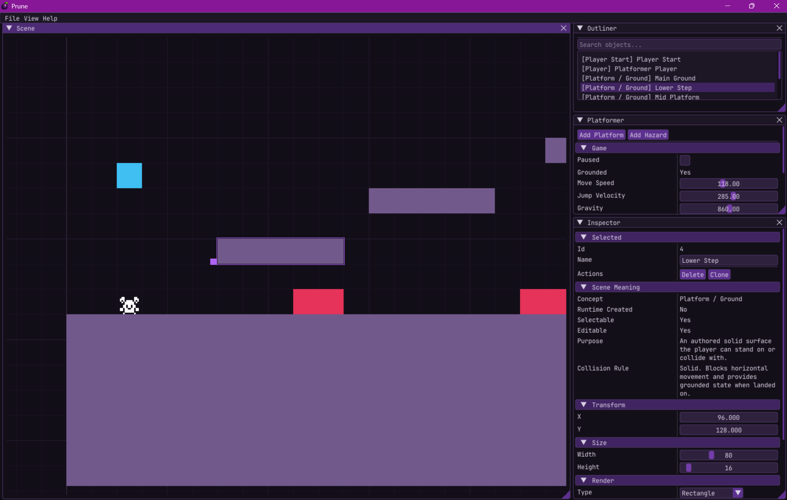
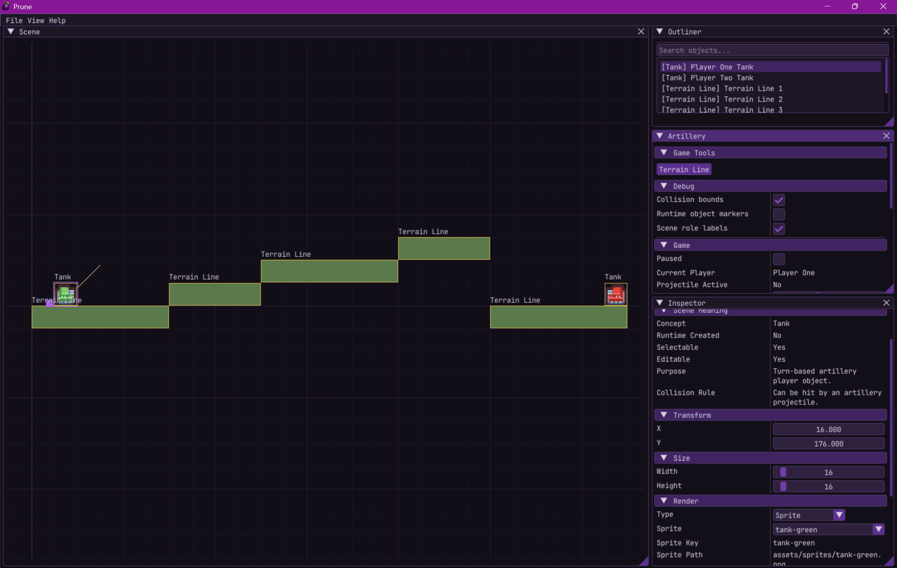
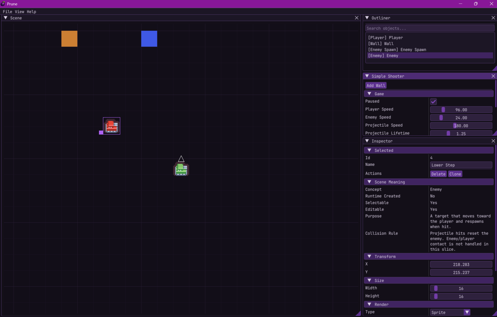

[](https://github.com/deanblackborough/Prune/actions/workflows/build.yml)
[](https://github.com/deanblackborough/Prune/actions/workflows/sanitize.yml)
[](https://github.com/deanblackborough/Prune/actions/workflows/format.yml)

# Prune


Prune is a C++23 live 2D editor/runtime prototype built with SDL2, SDL2_image, Dear ImGui, and yaml-cpp.

It is not trying to be a traditional engine where editing happens in one mode and gameplay happens in another. The goal is a play-and-build system where the editor remains part of the runtime.

Different scene types can share the same editor shell while defining their own behaviour, tools, panels, inspectors, object semantics, defaults, and save data.

> **Save compatibility warning**
>
> Prune is still pre-release. Existing `.yml` scene files may break while the object model, scene descriptors, behaviour ids, concept metadata, and scene-specific save data are being shaped.
>
> Save compatibility will matter later. For now, the priority is getting the scene model and editor/runtime architecture right.
>
> Camera movements do not mark the scene as dirty but they are saved to the scene file. If you are testing save/load, be aware that camera movements will be persisted.

## Why this exists

My earlier attempt, [prune-2d](https://github.com/deanblackborough/prune-2d), leaned too far towards building generic engine pieces first and hoping the editor and game would appear later.

Prune is take two.

The goal is to build the editor, runtime, and interaction model together from the start. That means solving editor problems early: viewport ownership, input focus, picking, object inspection, save/load, scene-specific behaviour, scene-specific tooling, and the boundary between generic editor tools and scene-owned tools.

## Core idea

Prune is built around a shared editor shell with scene-specific behaviour layered on top.

The shared side owns:

- Viewport
- Grid
- Camera foundations
- Selection
- Outliner
- Generic inspector
- Basic object editing
- Rendering foundations
- Save/load foundations
- Scene creation/loading flow

Each scene type owns:

- Object roles and semantics
- Runtime behaviour
- Scene-specific tools
- Scene-specific panels
- Scene-specific inspector sections
- Scene-specific object creation rules
- Scene-specific default layout
- Scene-specific save data

A simple shooter, platformer, artillery/tank game, card scene, or puzzle scene should be able to reuse most of the editor and general tools whilst still defining the parts that make that particular scene type unique.

The current goal is not to build complete games. The goal is to prove that multiple small game slices can coexist inside the same live editor/runtime without turning the scene layer into one large conditional mess.

As the project develops, the game slices will improve and expand. Tools will be added as scenes need them; as those tools arrive, game slice quality, features, and editor UX will improve.

### Platformer editor and runtime



### Artillery editor and runtime



### Simple shooter editor and runtime



## Prune is not...

Prune is not currently trying to be:

- A general-purpose commercial game engine
- A plugin-based editor framework
- An ECS experiment
- A complete platformer engine
- A complete shooter engine
- A complete artillery engine
- A stable scene file format

The project is still in the phase where concrete slices are being used to discover the right editor/runtime boundaries.

I have a [DECISIONS.md](DECISIONS.md) file which explains some of the choices I have made, and more importantly why I have rejected to do some things.

## Current architecture direction

The project is moving towards this rule:

> A new scene type should only need to define what makes it different.

That means a scene type should not need to reimplement generic viewport access, camera access, object manager access, grid access, generic rendering flow, generic editor interaction, or basic save/load plumbing.

The current architecture is intentionally not a plugin system, not an ECS, and not a general-purpose engine API. The code is still being shaped around concrete scene slices first.

Authored objects carry an explicit z-index so render order can be edited deliberately and persisted with the scene, and an architecture pass has since made the authoring boundary explicit: the authored store is the single source of truth for saved data, the live world is rebuilt from it, editing is only possible while a scene is Stopped, and editor presentation (Dear ImGui, tooling, scene editors) is structurally separated from runtime/scene code down to the CMake target level (`prune_runtime` has no ImGui dependency at all). See [DECISIONS.md](DECISIONS.md) for the reasoning. With that in place, the next focus is picked up in [NOTES.md](NOTES.md).

## Where we are now

Prune has moved beyond a single-scene prototype. The project now has a shared editor/runtime foundation with three scene slices proving that different game types can reuse the same editor while owning their own behaviour, semantics, tuning, inspector sections, and save data.

The current focus is no longer "can a scene run?" It is now "can scenes be edited clearly and safely while the runtime remains live?"

Prune currently has:

- Dedicated ImGui scene viewport
- Shared editor camera and game camera foundations
- Grid rendering and snapping
- Live object selection
- Selected-object outlines and transform handles
- Handle-based movement for authored movable objects
- Handle-based scaling for single authored objects, with minimum-size constraints
- Runtime object protection by default
- Outliner and generic inspector panels
- Scene-specific inspector sections
- Scene-aware object concepts (scene roles) for selection, editability, movement, runtime-only objects, and collision meaning
- YAML scene save/load
- Dirty state tracking for authored scene data
- An in-memory authored-object baseline used by save and runtime reset, preserving live editor changes while excluding runtime-only objects
- Scene factory creation and scene-type loading from save files
- Rectangle and sprite rendering
- Basic sprite resource map
- Shared Reset and Pause/Play runtime controls across all three scene slices, plus an explicit Stop state that is the only state in which authored fields can be edited
- Explicit authored-object render ordering (z-index) with a Z Index field and +1/-1 step buttons, persisted per scene; runtime-only objects always draw on top in spawn order
- Basic code-driven audio playback and scene event hooks; authored audio UI is deferred until the broader effects/reaction workflow is designed
- Shared scene renderer, interaction, camera, state, collision, serialization, and audio foundations
- Shared `WorldScene` foundation for scene types
- An authored store that is the single source of truth for saved scene data; the live world and all editor-session state (selection, undo/redo history, dirty flag, active tool, viewport, debug overlays) are built from it and never leak into the save file
- Typed `EditorCommand` payloads (a `std::variant`, not a type enum plus optional fields) so most new per-object edits reuse an existing payload rather than adding a new command type
- Explicit authored object concept identity, independent of runtime behaviour
- Editor presentation (Dear ImGui, tooling panels, scene editors) structurally separated from runtime/scene code, enforced at the CMake level: `prune_runtime` (no ImGui) and `prune_editor` are separate build targets, and the test suite links only `prune_runtime`
- Linux build (GCC 13 and Clang 18) alongside Windows/MSVC, both verified in CI, with the test suite run under AddressSanitizer (Windows and Linux) and UndefinedBehaviorSanitizer (Linux)
- Platformer scene slice
- Artillery game slice
- Simple Shooter scene slice

The first real editor tooling pass was completed when I added the transform gizmo. It was intentionally small: selected authored objects show a visible manipulation affordance, and movement starts from the handle rather than from arbitrary object-body dragging.

This mattered because it shifted Prune from "objects can be edited through panels" towards "the viewport itself is becoming an editor surface" which is what users will expect from a live editor/runtime.

## Editor model

Prune separates shared object editing from scene-specific behaviour.

The generic inspector shows shared object data and scene meaning; the scene-specific inspectors show what that object does in the current scene type.

- Scene meaning: What this object is in the context of the scene, authored or created by the runtime, selectable, editable, the purpose and collision rules.
- Scene type section: What the object is doing in the scene; for example, if it is the player, are they ready to shoot, is there a cooldown, what is the current speed, and so on.

## Current scene slices

The current scenes are proof slices. They are deliberately small, but they exercise different parts of the editor/runtime boundary.

They are not intended to be complete games yet, maybe one day.

### Platformer

The Platformer slice currently proves:

- Gravity
- Jumping
- Ground checks
- Solid platforms
- Hazards
- Player reset
- Scene-specific tuning panel
- Scene-specific save/load data

### Artillery

- Two player
- Individual player state
- Randomised levels (3 defined, random on reset)
- Game reset on tank collision
- Scene-specific tuning panel
- Scene-specific save/load data

### Simple Shooter

The Simple Shooter slice currently proves:

- Player movement
- Facing direction
- Shooting
- Runtime bullet objects
- Enemy movement
- Bullet/enemy collision
- Runtime cleanup
- Scene-specific tuning panel
- Scene-specific save/load data

## Near-term focus

Two phases are complete: the short-term hardening pass below, and a follow-on architecture
refactor that made the authored/runtime/editor boundary explicit and enforced (see "Current
architecture direction" above and [DECISIONS.md](DECISIONS.md)). Feature work resumes next,
starting with a rotation tool.

The hardening pass:

- [x] Initial implementation of dirty-state tracking for persistent editor-authored changes.
- [x] Keep editor command changes synchronised with the current authored state through execution, undo, redo, save, and runtime reset.
- [x] Add a Ctrl+S shortcut using the existing scene save workflow.
- [x] Add an explicit runtime reset that restores the current in-memory authored state and removes runtime-only objects.
- [x] Add consistent Reset and Pause/Play controls to the editor without marking the scene dirty.
- [x] Add authored object z-index ordering.
- [x] Persist and restore object ordering through scene save files.
- [x] Add basic editor actions for moving selected objects forward or backward in render order.

My development plan is tracked in [NOTES.md](NOTES.md) — check the file for what's next and why.

## Ready for users when...

The core editor/runtime loop is now working, but that does not mean Prune is ready for you to invest any meaningful time in it just yet.

I will consider Prune ready for early external users when someone unfamiliar with the codebase can create, edit, run, save, reload, and understand a small scene without modifying C++ or relying on undocumented project knowledge.

### Core editor/runtime

- [x] Open the application.
- [x] Select objects in the viewport.
- [x] Move authored objects using the move tool.
- [x] Resize authored objects using the scale tool.
- [x] Duplicate authored objects.
- [x] Delete authored objects.
- [x] Undo and redo editor changes.
- [x] Save and load scenes.
- [x] Reset runtime state without discarding current authored changes.
- [x] Pause and play scene runtime from the shared editor toolbar.
- [x] Preserve scene behaviour after loading.
- [x] Protect runtime-only objects from accidental editing and persistence.
- [x] Provide basic code-driven audio playback and scene audio hooks.

### Editor workflow

- [ ] Select a scene type when creating a new scene.
- [ ] Provide reliable new, open, save, save-as, and saved-scene reload workflows.
- [x] Track unsaved authored changes through editor commands, undo, redo, save, and load.
- [x] Show the current dirty state clearly in the editor.
- [x] Support Ctrl+S for normal scene saving.
- [ ] Warn before closing, reloading, or replacing a scene with unsaved changes.
- [x] Provide consistent Reset and Pause/Play runtime controls.
- [ ] Provide an explicit saved-scene reload workflow.
- [x] Add explicit authored-object render ordering.
- [ ] Apply grid snapping consistently across applicable editor tools.
- [ ] Provide object locking or protection for authored objects that should not be changed accidentally.

### Scene editing

- [ ] Provide a usable asset workflow that does not require editing source code.
- [ ] Allow sprites and audio resources to be selected and configured through the editor.
- [ ] Expose useful authored-object behaviour through editor controls.
- [ ] Provide editor-facing event and reaction configuration, including audio playback.
- [ ] Support basic scene-wide configuration such as background and music.
- [ ] Add sufficient text rendering support for practical scenes.
- [ ] Introduce scene file versioning before external users create files that need long-term compatibility.

### Proof Prune works and is usable

- [ ] Provide at least one polished example for each supported scene type.
- [ ] Ensure errors such as missing assets and invalid scene files are reported clearly.
- [ ] Document how to build, launch, create, edit, run, save, and reload a scene.
- [ ] Ensure a new user can complete the basic workflow without reading the engine source.
- [ ] Provide at least one practical way to package or share a playable scene. (This may be a simple zip of the scene file and assets, or a small standalone executable.)

### Build and portability

- [x] Build and run on Linux with GCC and Clang, not just Windows/MSVC.
- [x] Run CI across a GCC, Clang, and MSVC compiler matrix.
- [x] Run the test suite under AddressSanitizer (Windows and Linux) and UndefinedBehaviorSanitizer (Linux) in CI.
- [ ] Run a scripted headless session under the sanitizers (the runtime/editor split this needed is done; still needs a smoke/headless mode or a dummy SDL video driver).
- [x] Add a `.clang-format` config enforced in CI.
- [ ] Add a `clang-tidy` pass.

*Until all or the majority of the above is checked, please consider Prune an active 2D game engine and editor prototype rather than something you can depend.

## Documentation stance

It is too early for heavy internal documentation.

Useful documentation now:

- [README.md](README.md) explaining the project goal and current architecture direction
- [NOTES.md](NOTES.md) tracking next architecture work
- Short comments where C++ intent is not obvious
- [Scene-type checklist](docs/SCENE_TYPE_CHECKLIST.md)

Too early:

- Full API docs
- Deep class documentation
- Plugin author guide
- Long tutorials

The code is still moving too quickly. Documentation should help decision-making without fossilising unfinished architecture.

## Build

Prune is built with CMake and a C++23-capable compiler. Windows/MSVC is the primary development
platform; Linux (GCC 13 and Clang 18) is also built and tested in CI.

### Confirmed environments
- Windows, Visual Studio 2022/2026 / MSVC, CMake, vcpkg, C++23, Ninja or the Visual Studio CMake generator
- Linux (Ubuntu 24.04), GCC 13 or Clang 18, CMake, Ninja, C++23, system packages instead of vcpkg (see below)

### Dependencies

Prune uses SDL2, SDL2_image, and yaml-cpp. Dear ImGui is included in the repository under
`external/`.

On Windows, dependencies are managed through `vcpkg.json` and resolved automatically via the
vcpkg CMake toolchain file. On Linux, install them as system packages instead (this is what CI
does, on Ubuntu 24.04):

```bash
sudo apt-get install -y ninja-build gcc-13 g++-13 \
  libsdl2-dev libsdl2-image-dev libyaml-cpp-dev catch2
```

### Configure and build — Windows (PowerShell)

```powershell
cmake -B build -S . `
  -DCMAKE_TOOLCHAIN_FILE=C:/dev/vcpkg/scripts/buildsystems/vcpkg.cmake
cmake --build build
```

For a release build:

```powershell
cmake --build build --config Release
```

### Configure and build — Linux

```bash
cmake -S . -B build -G Ninja -DCMAKE_BUILD_TYPE=Debug
cmake --build build
```

### Run

The executable is created in the CMake build output directory. The exact path depends on the
generator used.

For Visual Studio generators, the executable will usually be under `build/Release/Prune.exe` or
`build/Debug/Prune.exe`. On Linux with Ninja, it is `build/Prune`.

### Notes

- Windows/MSVC is the primary development platform; Linux (GCC 13, Clang 18) is built and tested
  in CI alongside it.
- GitHub Actions builds and tests the project on both Windows and Linux (GCC and Clang), runs the
  test suite under sanitizers (AddressSanitizer on Windows and Linux, UndefinedBehaviorSanitizer
  on Linux), and checks formatting.
- `Prune` links two internal static libraries, `prune_runtime` (scenes/behaviour, no ImGui) and
  `prune_editor` (tooling, ImGui); `PruneTests` links only `prune_runtime`. Nothing in the build
  invocation above changes because of this — it's handled inside `CMakeLists.txt`.
- macOS is not CI-verified, but builds locally with Clang via vcpkg, the same as Windows; the
  repository's `CMakePresets.json` has a `mac-debug` preset if you want one.
- If CMake cannot find SDL2, SDL2_image, or yaml-cpp, check the vcpkg toolchain path (Windows) or
  that the system packages above are installed (Linux).

## Acknowledgements

- [SDL2](https://www.libsdl.org/) — windowing, input, and rendering foundation
- [Dear ImGui](https://github.com/ocornut/imgui) — editor UI
- [yaml-cpp](https://github.com/jbeder/yaml-cpp) — scene save/load
- [SDL2_image](https://github.com/libsdl-org/SDL_image) — sprite loading
- [The Cherno](https://www.youtube.com/@TheCherno) — C++ game engine architecture and editor design inspiration
- [Kenny](https://kenney.nl/) — free game assets for prototyping
- [jsfxr](https://sfxr.me/) - free sound effect generator for prototyping

## Licence

MIT — see [LICENSE](LICENSE)
